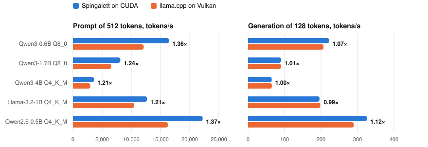
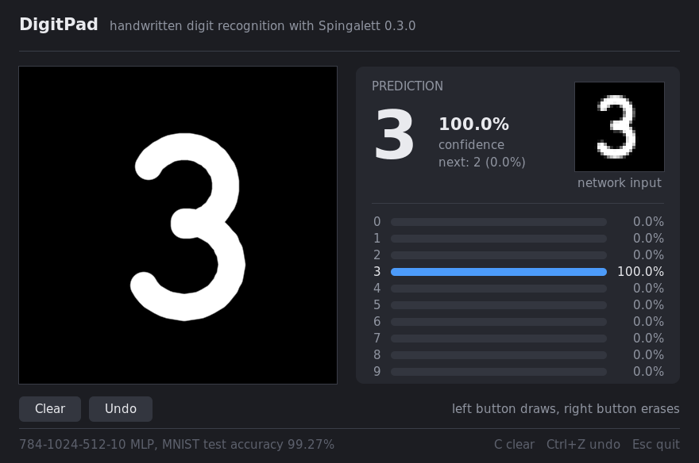

<div align="center">

<picture>
  <source media="(prefers-color-scheme: dark)" srcset="Images/LogoDark.png">
  <source media="(prefers-color-scheme: light)" srcset="Images/LogoLight.png">
  
</picture>

**Neural networks in C23, from microcontrollers to GPUs.**<br>
Train them, quantize them and run them, with kernels of its own and no dependencies.

[](https://github.com/pka-human/Spingalett/actions/workflows/ci.yml)
[](https://pypi.org/project/spingalett/)
[](https://github.com/pka-human/Spingalett/releases)
[](https://en.wikipedia.org/wiki/C23_(C_standard_revision))
[](LICENSE)
[](https://deepwiki.com/pka-human/Spingalett)

[**Quick start**](#quick-start) · [**Speed**](#speed) · [**Install**](#install) · [**Documentation**](docs/README.md) · [**Roadmap**](ROADMAP.md) · [**Changelog**](CHANGELOG.md)

</div>

Spingalett trains and runs dense, convolutional and transformer networks, GGUF language models as they are stored, and
any model built of ONNX's operators. The same library runs on a CPU, on NVIDIA's GPUs through CUDA and on any GPU through
Vulkan; its engine runs on a microcontroller without a heap and in a browser through WebAssembly.

<table>
<tr>
<td width="33%" valign="top">

**Its own kernels**

Matrix products for AVX-512, AVX2, NEON and portable C, chosen at run time. GPU kernels without the CUDA toolkit,
cuBLAS or cuDNN.

</td>
<td width="33%" valign="top">

**No dependencies**

Only the C standard library. The CUDA driver and the Vulkan loader are opened at run time, where a machine has them.
OpenMP and OpenBLAS are options.

</td>
<td width="33%" valign="top">

**The same bits**

Training gives the same bits on one thread and on many. Integer models give the same bits on every backend. A stopped
run resumes to the bits of one that never stopped.

</td>
</tr>
<tr>
<td valign="top">

**Models from anywhere**

GGUF files, Hugging Face directories, ONNX files (155 operators), `torch.save` and safetensors weights.

</td>
<td valign="top">

**Training as well as inference**

Every kind of layer trains on the CPU and on both GPU backends, in `train()` or in a program's own loop.

</td>
<td valign="top">

**Small when it has to be**

Models from FP32 down to INT2, run in place from flash. The engine is one C file. The runtime, without training, is a
quarter of the library's size.

</td>
</tr>
</table>

## Quick start

```bash
pip install spingalett      # the wheel holds the library; other packages are under Install
```

### Run a language model

A GGUF file runs as it is stored, in its own quantized type. A model larger than the GPU's memory splits with the CPU.

```python
import spingalett as sg

sg.set_compute_mode(sg.ComputeMode.CUDA)        # or VULKAN; without such a GPU, the CPU
with sg.Model.load("Qwen3-0.6B-Q8_0.gguf", context=4096) as model, model.session() as s:
    tok = sg.Tokenizer("Qwen3-0.6B-Q8_0.gguf")
    prompt = tok.encode("The capital of France is", add_special=True)
    print(tok.decode(s.generate([prompt], 32)[0]))
```

### Train a network

```python
import numpy as np
import spingalett as sg

x = np.array([[0, 0], [0, 1], [1, 0], [1, 1]], dtype=np.float32)
y = np.array([[0], [1], [1], [0]], dtype=np.float32)

with sg.Network(sg.Loss.MSE, [sg.Layer(2),
                              sg.Layer(16, sg.Activation.TANH, sg.Init.XAVIER),
                              sg.Layer(1, sg.Activation.SIGMOID, sg.Init.XAVIER)]) as net:
    net.train(x, y, epochs=3000, optimizer=sg.Optimizer.ADAM, learning_rate=0.02)
    print(net.forward(x))
    with net.to_model(sg.Precision.INT8) as model:      # a deployment model on integer kernels
        print(model.predict(x), model.size, "bytes")
```

<details>
<summary><b>The same network in C</b></summary>

```c
#include <Spingalett/Spingalett.Short.h>
#include <stdio.h>

int main(void) {
    float inputs[4][2]  = {{0, 0}, {0, 1}, {1, 0}, {1, 1}};
    float targets[4][1] = {{0}, {1}, {1}, {0}};

    NeuralNetwork *net = new_spingalett(LOSS_MSE);
    layer(net, 2);                                              /* input layer */
    layer(net, 8, ACT_TANH, WEIGHT_INITIALIZATION_XAVIER);
    layer(net, 1, ACT_SIGMOID, WEIGHT_INITIALIZATION_XAVIER);

    train(
        .net = net,
        .inputs = &inputs[0][0],
        .targets = &targets[0][0],
        .sample_count = 4,
        .epochs = 5000,
        .training_strategy = STRATEGY_FULL_BATCH,
        .optimizer_type = OPTIMIZER_ADAM,
        .learning_rate = 0.02f,
        .report_interval = 1000
    );

    for (int i = 0; i < 4; i++) {
        float *out = forward(net, inputs[i]);
        printf("%.0f XOR %.0f = %.4f\n", inputs[i][0], inputs[i][1], out[0]);
    }

    save_spingalett(.net = net, .filename = "xor");             /* writes xor.slett */
    free_network(net);
    return 0;
}
```

</details>

### Run any ONNX model

```python
import numpy as np
import spingalett as sg

graph = sg.Graph.load("model.onnx")
print(graph.inputs, graph.run({"image": np.zeros((1, 3, 224, 224), np.float32)}))
```

The [tutorial](docs/Tutorial.md) goes on from here through six programs, up to a model on a microcontroller.

## Speed

Every number is measured on one machine, with the rival in the same runs: an Intel Core i7-12650H and an NVIDIA GeForce RTX
4050 Laptop GPU with 6 GB. Reproduce them with `Bin/Benchmark`, `Examples/benchmark_pytorch.py` and `Bin/LlmBench`.

### Language models on a GPU

<picture>
  <source media="(prefers-color-scheme: dark)" srcset="Images/SpeedDark.svg">
  <source media="(prefers-color-scheme: light)" srcset="Images/SpeedLight.svg">
  
</picture>

The same GGUF files, `llama-bench -p 512 -n 128` against `LlmBench`. A generated token's products are bound by the
memory's bandwidth, which both reach to within a few percent. llama.cpp's CUDA build was not measured.
[The numbers, with Vulkan's](docs/Performance.md#language-models-on-the-gpu).

On the CPU, on six performance cores, prompts run 1.6 to 2.9 times as fast as llama.cpp's and generation 1.00 to 1.10
times.

### Training and inference against PyTorch

How many times as fast as PyTorch 2.14.1, training / inference. On the CPU against its MKL and oneDNN build, on eight
threads; on the GPU in bfloat16 against the fastest of its runs in bfloat16, by default or with `torch.compile`
(`max-autotune`), the data in GPU memory.

| Network | CPU | GPU (CUDA) |
|---|:---:|:---:|
| ResNet-20 | 1.8× / 2.8× | 1.11× / 1.21× |
| Convolutional network for MNIST | 2.3× / 3.9× | 1.9× / 2.3× |
| U-Net, 64 x 64 | 1.6× / 3.3× | 1.03× / 1.19× |
| MobileNet-style network | 2.0× / 4.2× | 1.46× / 2.4× |
| GPT, nanoGPT's configuration | 1.6× / 11.3× | 1.02× / 1.05× |
| 784-512-1000-10 MLP, mini-batches | 2.0× / 1.7× | 4.1× / 1.6× |

[All the workloads, single precision and data from the host](docs/Performance.md).

### Not ahead yet

The aim is 1.3 times the strongest rival in every workload. These fall short, and stay [on the roadmap](ROADMAP.md) until
they do not:

- **Sessions on Vulkan** give correct results, but run prompts at 0.26 to 0.50 times llama.cpp's speed and generation at 0.65
  to 0.82 times. AMD's and Intel's GPUs have not been measured.
- **Graphs of operators against PyTorch**, milliseconds in bfloat16 with its tensors already on the GPU: GPT-2 3.76 (3.03),
  Whisper's encoder 3.51 (3.04), ViT-B/16 3.47 (3.30). Of the eight models measured, only the SDXL-style UNet is 1.3 times
  ahead: 4.01 (13.6). On the CPU, graphs run at 0.63 to 0.94 times PyTorch's speed.
- **A model that barely fails to fit**: Qwen3-8B on 6 GB keeps its output layer on the CPU, which costs 0.83 times the
  generation of llama.cpp, which fits it whole.

## What runs where

| | CPU | CUDA<br>NVIDIA, Ampere and later | Vulkan<br>NVIDIA, AMD, Intel, Apple | Microcontrollers<br>and WebAssembly |
|---|:---:|:---:|:---:|:---:|
| Training networks of layers, transformers among them | ✓ | ✓ | ✓ | |
| Deployment models, FP32 to INT2 | ✓ | ✓ | ✓ | ✓ |
| Sessions of language models, batched generation | ✓ | ✓ | ✓ | |
| GGUF's twelve block types, llama.cpp's quantizers byte for byte | ✓ | ✓ | ✓ | engine, no sessions |
| Graphs of operators: any ONNX model | ✓ | ✓ | ✓ | planned, 1.13 |
| Training graphs of operators | planned, 1.7 | planned, 1.7 | planned, 1.7 | |

**Language models:** LLaMA 1 to 3.x, Mistral, Qwen2 to Qwen3, Gemma 3, GPT-2, SmolLM3, OLMo 2, Phi-3 and GLM-4 from GGUF
files; tokenizers, chat templates and sampling as llama.cpp offers it, in C.

**Checked:** ONNX's 1262 conformance cases, whole models against PyTorch, ONNX files against ONNX Runtime, GGUF models
against llama.cpp. [Every feature](docs/Features.md).

## Install

```bash
pip install spingalett
brew tap pka-human/spingalett https://github.com/pka-human/Spingalett && brew install spingalett
scoop bucket add spingalett https://github.com/pka-human/Spingalett && scoop install spingalett
nix build github:pka-human/Spingalett
docker run --rm --gpus all ghcr.io/pka-human/spingalett:1.6.1
```

[Releases](https://github.com/pka-human/Spingalett/releases) hold archives for Linux (x86-64, AArch64), Windows and macOS,
`.deb` and `.rpm` packages, and the runtime alone. To build from source, with CMake 3.21 and a C23 compiler (GCC 13 or Clang
18):

```bash
cmake -S . -B Build -DCMAKE_BUILD_TYPE=Release -DBUILD_WITH_OPENMP=ON
cmake --build Build --parallel
ctest --test-dir Build --output-on-failure
```

[Every option, CMake packages, pkg-config, Conan and vcpkg](docs/Installing.md).

## Languages

| Language | Interface | |
|---|---|---|
| **C** | [`Spingalett.h`](Include/Spingalett/Spingalett.h), the runtime's [`Spingalett.Runtime.h`](Include/Spingalett/Spingalett.Runtime.h), the engine's [`Spingalett.Inference.h`](Include/Spingalett/Spingalett.Inference.h) | [Reference](docs/Reference.md) |
| **Python** | `pip install spingalett`, wheels with the library inside | [Guide](Bindings/Python/README.md) |
| **C++23** | `Spingalett.hpp`, header-only: `std::span`, `std::expected` | [Guide](docs/Bindings.md#c) |
| **Rust** | crates `spingalett` and `spingalett-sys` | [Guide](Bindings/Rust/README.md) |
| **C#** | package `Spingalett`, .NET 8 or later | [Guide](Bindings/CSharp/README.md) |
| **Go** | module `github.com/pka-human/Spingalett/Bindings/Go` | [Guide](Bindings/Go/README.md) |
| **Java** | the foreign function and memory API, Java 22 or later | [Guide](Bindings/Java/README.md) |
| **PHP** | package `pka-human/spingalett`, the FFI extension | [Guide](Bindings/PHP/README.md) |
| **JavaScript** | the inference engine in WebAssembly, for Node and browsers | [Guide](Bindings/JavaScript/README.md) |

## DigitPad

[A desktop demo](Apps/DigitPad): draw a digit with the mouse, and a network classifies it as you draw. Its convolutional
network reaches 99.58% on MNIST's test set. Every release attaches it as a Linux AppImage and a Windows zip.

<p align="center"></p>

## Documentation

| Learn | Use | Look up |
|---|---|---|
| [Getting started](docs/GettingStarted.md) | [Language models](docs/LanguageModels.md) | [API reference](docs/Reference.md) |
| [Tutorial](docs/Tutorial.md) | [Inference and deployment](docs/Deployment.md) | [All features](docs/Features.md) |
| [Networks](docs/Networks.md) | [Graphs of operators](docs/Graphs.md) | [Performance](docs/Performance.md) |
| [Training](docs/Training.md) | [Models from elsewhere](docs/Importing.md) | [Model format](docs/ModelFormat.md) |
| [Data sets](docs/Datasets.md) | [Backends and the GPU](docs/GPU.md) | [Data set format](docs/DatasetFormat.md) |
| [Installing and building](docs/Installing.md) | [Bindings](docs/Bindings.md) | [Compatibility](docs/Compatibility.md) |

## Status

Spingalett is at version 1.6.1. Every 1.x release keeps the API, the ABI (the soname `libspingalett.so.1`) and the file
formats: [what that promises](docs/Compatibility.md).

Next: SaLaM, a command-line program for language models on the runtime, in its own repository; 1.7, training through graphs
and language models as graphs; 1.8, diffusion. Then mixtures of experts, hybrid models, trees, reinforcement learning, Arm
and Apple, several GPUs: [the roadmap](ROADMAP.md).

## Contributing

Bug reports and pull requests are welcome: [how to contribute](CONTRIBUTING.md), and [AGENTS.md](AGENTS.md) for the
invariants the tests hold.

## License

[MIT](LICENSE).
